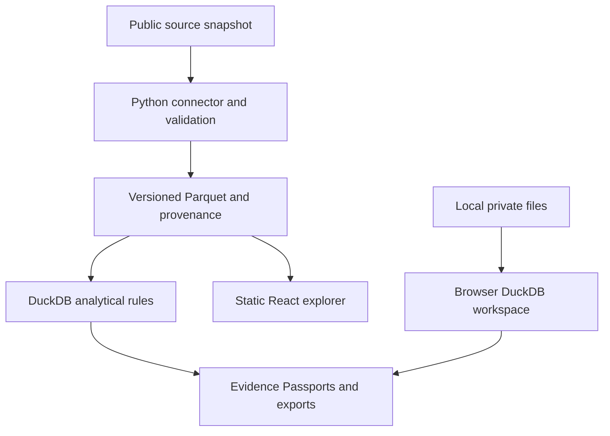

# CivicTrace

**Follow the money. Verify the evidence.**

Free, open-source investigative analytics for journalists, auditors, researchers, NGOs,
students and anyone who wants to understand public spending. No registration, billing,
subscriptions or paid application features are planned. Donations and independent services
may support maintenance; analytical outcomes cannot be purchased.

**Status: repository foundation, version 0.0.1. This is not a production investigation platform.**
CivicTrace is a provisional working name with known existing uses; see [branding assessment](docs/BRANDING.md).

## Why this exists
Public spending and corporate records are fragmented, difficult to compare, and often lack
reproducible explanations. CivicTrace aims to connect documented facts to transparent
calculations and explicit limitations. An anomaly is a reason to investigate, not proof of crime.

## What works today
- A dependency-free Python CLI reads an original synthetic JSON fixture locally.
- One demonstration rule flags exactly one reported bid, without imputing missing counts.
- Deterministic JSON Evidence Passports carry source references, snapshot hashes, rule versions,
  calculations, limitations and verification steps.
- Unit and CLI tests, an Evidence Passport JSON Schema, CI and contributor policies.

There is no real-source connector, searchable frontend, Parquet pipeline, DuckDB execution,
corporate graph, hosted deployment, sanctions engine or financial-file import yet.

## Quick start
Python 3.11 or newer; commands run from the repository root:

```bash
python -m venv .venv
# Linux/macOS: source .venv/bin/activate
# Windows PowerShell: .venv\Scripts\Activate.ps1
python -m pip install -e ".[dev]"
civictrace examples/synthetic_procurement.json --collected-at 2026-10-10T00:00:00Z --output findings.json
pytest -q
ruff check .
ruff format --check .
python scripts/check_docs.py
```

The output must be a new file. Keep your own data outside the repository. The CLI does not
fetch, upload or transmit files. Without optional tools, the smoke suite can also run:

```bash
# Linux/macOS; PowerShell: $env:PYTHONPATH = "backend/src"
PYTHONPATH=backend/src python -m unittest discover -s tests -v
```

The JSON Schema test requires `jsonschema`, installed by the dev extra and in CI.
See [development](docs/DEVELOPMENT.md) for reproducibility and environment notes.

## Planned modules
| Module | Intended capabilities | Status |
| --- | --- | --- |
| Public Procurement Intelligence | Concentration, single bids, submission windows, modifications, completeness | Synthetic single-bid demo only |
| Financial Forensic Toolkit | Local payment/journal tests, reconciliation, SQL, CSV/Excel/Parquet | Planned v0.2 |
| Corporate Relationship Intelligence | Identifiers, ownership, temporal graphs, authorized sanctions sources | Planned v0.3 |
| Cyber Intelligence | Passive advisories, public infrastructure evidence, hashes | Planned v0.5 |
| Economic Research Lab | Python/R statistics, econometrics, time series, peer groups | Planned v0.4 |
| Investigation Studio | Evidence Passports, timelines, source-linked export packages | Passport foundation only |

## Example investigation
Select a legally reusable procurement snapshot, preserve its bytes and hash, normalize its
records, and inspect data quality. Compare a buyer's suppliers within a stated period and currency.
Review a single-bid flag against the notice and procedure. Export facts, calculations and
interpretation separately, with source attribution and a correction path.
The bundled example uses invented organizations and cannot substantiate a real allegation.

## Architecture and technology

This diagram is the target architecture. Current code implements a small local JSON path only.
Python, Polars, Pydantic, Parquet and DuckDB support a single-machine data pipeline. React,
TypeScript and Vite support a static explorer; DuckDB-Wasm will be introduced with measured
browser memory limits. R, SciPy/statsmodels and Quarto are future research tools. Cytoscape.js
is deferred until sourced graph relationships exist. Pytest is initial tooling; Vitest and
Playwright arrive with the frontend. No server, accounts or permanent cloud database is needed
for the initial scope. [Architecture](docs/ARCHITECTURE.md) and [decisions](docs/adr/0001-local-first-foundation.md).

## Sources and evidence
Recommended first source: a bounded historical **Paraguay DNCP OCDS** export through the
Open Contracting Data Registry, subject to rechecking publisher terms before publication.
The registry lists CC BY 4.0; the linked publisher legal page failed verification, so public
redistribution is gated. No live data has been imported or republished.
TED, GLEIF, official OFAC sources and Serbian procurement are assessed in [data sources](docs/DATA_SOURCES.md).
Software licensing does not override dataset licensing. See [data policy](DATA_POLICY.md).

Every finding should carry an [Evidence Passport](docs/EVIDENCE_PASSPORT.md). Name similarity
is not entity identity; a sanctions name candidate is not a legal determination. Models must
state assumptions, unknown values, exclusions, uncertainty and reproducible methodology.
Private files remain local by default. Sensitive submissions and evidence hosting are excluded.
See [security model](docs/SECURITY_MODEL.md) and [security disclosure](SECURITY.md).

## Roadmap and contribution
[v0.1 procurement explorer → v0.2 local financial forensics → v0.3 corporate networks →
v0.4 statistical research → v0.5 passive cyber → v1.0 integrated platform](ROADMAP.md).
These are proposed milestones, without promised dates. See the [actionable backlog](docs/BACKLOG.md).

Read [CONTRIBUTING](CONTRIBUTING.md) and [contributor guide](docs/CONTRIBUTOR_GUIDE.md).
Propose features using the issue templates, including public benefit, source rights, sample
synthetic inputs and testable outcomes. Documentation examples and validation edge cases are
first-contribution candidates. [Governance](GOVERNANCE.md) describes review, independence,
conflicts of interest and corrections.

## Funding and license
[FUNDING](FUNDING.md) explains voluntary donations, grants and sponsorship independence.
No payment account or sponsorship link is configured.

[Apache-2.0](LICENSE) covers original project software, documentation and synthetic examples.
External datasets retain their own licenses and attribution. Apache-2.0 preserves permissive
reuse with an explicit patent grant; MIT is shorter but lacks that explicit provision.
No warranty, fraud probability or legal/compliance certification is provided.
