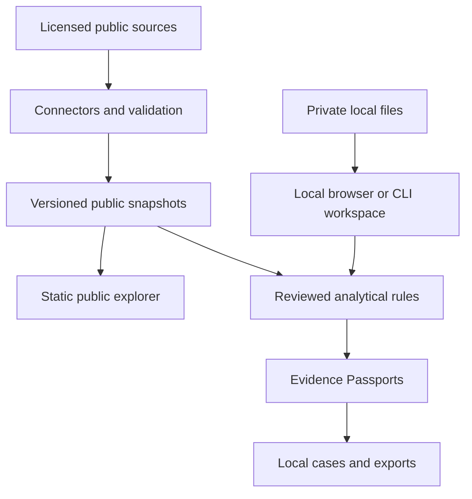

# CivicTrace

**Follow the money. Verify the evidence.**

CivicTrace aims to become a free, open-source investigation and research workbench that brings
public procurement, financial forensics, corporate relationships, passive cyber intelligence and
reproducible data science into one evidence-backed workflow.

Built for journalists, auditors, researchers, NGOs, students, developers and curious citizens.
Professional analytical tools should be available without payment or registration. All core
modules and analytical features are intended to remain free. Voluntary funding can support the
project; sponsors cannot buy favorable findings or suppress results.

> **Current release: 0.0.1 foundation.** The working software is an offline Python demo using
> synthetic procurement records. The capabilities below are a proposed product direction unless
> explicitly marked implemented. CivicTrace is a provisional name with known existing uses;
> see the [branding assessment](docs/BRANDING.md).

## Contents

- [Mission and product principles](#mission-and-product-principles)
- [The final-product experience](#the-final-product-experience)
- [What works today](#what-works-today)
- [Six connected modules](#six-connected-modules)
- [Investigation workflows](#investigation-workflows)
- [Evidence Passports](#evidence-passports)
- [Shared product capabilities](#shared-product-capabilities)
- [Architecture and technology](#architecture-and-technology)
- [Data sources and country coverage](#data-sources-and-country-coverage)
- [Roadmap to v1.0](#roadmap-to-v10)
- [What makes v1.0 ready](#what-makes-v10-ready)
- [After v1.0](#after-v10)
- [Run the current demo](#run-the-current-demo)
- [Contributing and learning](#contributing-and-learning)
- [Funding and independence](#funding-and-independence)
- [Policies and documentation](#policies-and-documentation)

## Mission and product principles

Financial and corporate records are fragmented across countries, formats and publication systems.
Investigative tools often require expensive subscriptions, specialized infrastructure or opaque
risk scores. CivicTrace will help people turn accessible data into inspectable calculations,
documented relationships and reproducible reports.

1. **Free access:** no mandatory account, subscription, billing or paid analytical tier.
2. **Evidence before interpretation:** show the source, calculation, limitations and verification
   steps behind every finding. An unusual pattern is a lead, not proof of wrongdoing.
3. **Local privacy:** analyze private files on the user's device by default. Public hosting serves
   approved public data; private workspaces do not silently upload evidence.
4. **Reproducibility:** another analyst should be able to repeat an analysis from its snapshot,
   method, parameters and environment.
5. **Open methods:** rules, schemas, statistical assumptions and changes are reviewable.
6. **Accessible design:** useful workflows for nonprogrammers alongside Python, SQL and R tools.
7. **Independent stewardship:** disclose material conflicts and funding; preserve corrections and
   methodological decisions.
8. **Measured scale:** establish useful single-machine performance before adding expensive or
   distributed infrastructure.

## The final-product experience

The target is a cohesive investigation workbench. A user should be able to open a public explorer,
inspect a buyer, supplier or documented company relationship, check its original source, run an
explained analytical rule, add a finding to a local research case and export a reproducible package.
A technical analyst should be able to perform the same steps through a CLI or reviewed code.

| Experience | Intended user outcome | Data boundary |
| --- | --- | --- |
| Public explorer | Search approved procurement records, entities, relationships and findings | Licensed, minimized public snapshots; no registration |
| Local analytical workspace | Import financial files, map columns, validate and run analytical tests | User's browser or local Python process; no automatic uploads |
| Investigation Studio | Organize evidence, review interpretations, build timelines and export a case | Local files and explicitly chosen exports |
| Research and developer workspace | Query in SQL, reproduce Python/R analyses and contribute methods | Reviewed packages and explicit file contracts |

Users should retain control of their files and exports. The public service is not intended to
become a confidential evidence repository. Optional organizational self-hosting may follow later
without making accounts a condition of public access or local analysis.

## What works today

| Capability | Status in 0.0.1 |
| --- | --- |
| Offline Python CLI | Implemented; reads a synthetic JSON fixture locally |
| Single-bid demonstration | Implemented; flags exactly one reported bid and preserves unknown counts |
| Evidence Passport JSON | Implemented; deterministic output, snapshot hash, rule version and limitations |
| Passport JSON Schema | Implemented; versioned machine-readable contract |
| Unit, provenance and CLI tests | Implemented; includes rejection cases and refusal to overwrite exports |
| CI and contributor policies | Implemented; Python checks, documentation checks and issue templates |
| Live data connectors, web interface and search | Planned |
| DuckDB/Parquet pipeline and local financial imports | Planned |
| Corporate graphs, R research and passive cyber modules | Planned |
| Public deployment, collaboration and report builder | Planned |

The [20-task backlog](docs/BACKLOG.md) defines the first procurement release. The
[current state](docs/CURRENT_STATE.md) records implemented work; this README defines the longer
product direction. Existing CI does not establish readiness for real investigative use.

## Six connected modules

### 1. Public Procurement Intelligence

Understand who buys, who wins, how competition changes and where documentation needs review.

- Search buyers, suppliers, tenders, awards and contracts using identifiers and explicit filters.
- Analyze supplier concentration, repeated awards, single-bid participation and submission windows.
- Compare contract values within stated currency, category, period and procedure cohorts.
- Trace amendments, cancellations, award/contract differences and changes over time.
- Inspect completeness, missing dates, inconsistent identities and excluded records.
- Extend coverage through country connectors using OCDS where applicable.

**Initial production scope:** one reliable public source, three documented indicators, searchable
records, source-linked Evidence Passports and CSV/JSON exports. The current single-bid code is
only a synthetic demonstration; it does not yet model real procedure, release or lot semantics.

### 2. Financial Forensic Toolkit

Help users investigate their own transaction data and general ledgers locally.

- Import CSV and Parquet first; add Excel after parser and export-safety review.
- Map dates, account codes, journal IDs, counterparties, debit/credit and currency columns.
- Reconcile input totals, validate balances and identify missing or inconsistent records.
- Test duplicate payments, repeated references, reversals, unusual timing, round values and
  documented journal-entry patterns.
- Inspect account/counterparty activity, aging, concentration and period cut-off patterns.
- Trace transaction flows within explicitly supplied ledger/payment records, preserving source
  references and distinguishing accounting entries from confirmed movement of funds.
- Run parameterized SQL rules and reproducible Python analyses with explainable results.
- Generate exception schedules with selection criteria, denominators and source-row references.

**Boundary:** analytical support rather than a full accounting, ERP or audit-opinion system.
Statistical tests need a suitable population; Benford deviations do not establish fraud.
Private financial records must stay out of public snapshots, repository fixtures and CI logs.

### 3. Corporate Relationship Intelligence

Explore documented entities and relationships across time and jurisdictions.

- Normalize identifiers using scheme, registration number, jurisdiction and source version.
- Link public parent/subsidiary and ownership records where the source actually supports them.
- Distinguish legal ownership, accounting consolidation, commercial relationships and inferred
  name candidates; these are different claims.
- Preserve validity periods, contradictory records, reporting exceptions and unknown ownership.
- Explore sourced graphs and paths with the evidence behind each edge.
- Add authorized official sanctions-list screening with dates, programs and candidate review.
- Investigate trade or supply-chain links when licensed public records support those relationships.

**Boundary:** fuzzy name similarity is a candidate match, not verified identity. Sanctions-screening
output is a research lead, not a determination of legal status or a substitute for specialist review.
GLEIF coverage must not be presented as a complete company or beneficial-ownership register.

### 4. Cyber Intelligence

Connect passive public digital evidence to documented research questions.

- Explore public vulnerability datasets, advisories and relevant identifiers such as CVEs.
- Use legally reusable domain, certificate or infrastructure records with clear coverage limits.
- Track public digital relationships and changes without implying that shared infrastructure
  establishes common ownership or malicious activity.
- Verify file hashes and preserve acquisition and transformation records.
- Combine public cyber context with entity research through source-backed, typed relationships.

**Boundary:** public, passive research only. No unauthorized scanning, intrusion, credential
collection, covert surveillance or attack tooling. No implied identification of hidden operators
from weak technical signals.

### 5. Economic Research Lab

Make statistical and economic research repeatable and reviewable.

- Descriptive statistics, peer-group comparisons, distributions and concentration measures.
- Hypothesis tests with explicit assumptions, sample definitions and multiple-testing treatment.
- Time-series analysis, econometric models and documented diagnostics.
- Clustering and anomaly detection with explainable features and validation.
- Python/R notebooks and Quarto reports backed by pinned data snapshots and environments.
- Sensitivity analysis, benchmark comparison and out-of-sample checks where appropriate.

**Boundary:** separate exploratory results from validated models and causal claims. No arbitrary
fraud probability. Publish model limitations, missing-data treatment and suitability criteria.

### 6. Investigation Studio

Turn research into a traceable, reviewable investigation package.

- Local research cases, questions, findings, evidence references and analyst notes.
- Evidence Passports, event timelines and entity/transaction links with typed source claims.
- Finding review states such as draft, needs verification, corroborated observation and disputed.
- Separate facts, computations, interpretations, third-party allegations and verification steps.
- Export machine-readable data first; add readable HTML/PDF reports after rendering and safety checks.
- Package source manifests, permitted evidence, methodology, parameters, environment and results.
- Record corrections and superseded conclusions without silently rewriting history.

**Boundary:** an analyst's review label is not judicial proof. Exporting original source files depends
on source rights and privacy. Confidential whistleblower intake and sensitive hosted evidence are
outside the initial product scope.

## Investigation workflows

These are intended workflows, not claims that the full application already implements them.

| Workflow | Steps | Useful output |
| --- | --- | --- |
| Public spending review | Select a licensed snapshot → validate → filter a cohort → inspect indicators → verify source records | Source-backed procurement findings and comparison tables |
| Local payment analysis | Import transactions → map fields → reconcile totals → test duplicates/timing → review exceptions | Local exception schedule with precise row references |
| Corporate network research | Identify entities → review relationship sources → explore dated paths → challenge candidate matches | Graph and edge-by-edge provenance |
| Passive digital-context research | Select public advisories/infrastructure evidence → validate dates and claims → connect documented entities | Referenced context without an unsupported attribution claim |
| Reproducible economic study | Define question/population → choose method → test assumptions → compare robustness → export | Notebook/report with data and environment manifests |
| Integrated investigation | Combine approved public records and local analysis → organize findings → verify → export | Reviewable research package that preserves privacy boundaries |

**Illustrative case:** a journalist notices repeated awards to one supplier. Procurement analysis
quantifies concentration within a stated cohort. Corporate research identifies a documented parent
relationship. Statistical checks compare like-for-like awards. Investigation Studio records what
was observed, what was calculated, plausible explanations and what still needs corroboration.
None of these steps alone proves corruption. Demonstrations use invented organizations.

## Evidence Passports

An Evidence Passport is the shared record behind a finding across all modules. Its target contract
includes:

| Information | Why it matters |
| --- | --- |
| Finding ID and schema version | Stable reference and compatible interpretation |
| Publisher and source URL/reference | Path back to the original evidence |
| Collection timestamp and original record ID | What was collected and when |
| Original-file hash and snapshot/version | Byte identity and reproducible inputs |
| Rule ID/version and calculation | Inspectable method |
| Parameters, cohort and observed result | Repeatable selection and computation |
| Comparator, numerator/denominator and exclusions where relevant | Context and honest coverage |
| Data-quality limitations and uncertainty | What the finding cannot establish |
| Facts, interpretation and separately attributed allegations | Prevent inference from masquerading as evidence |
| Verification steps and correction lineage | Practical follow-up and accountable revision |

The [current schema](schemas/evidence-passport.schema.json) supports the foundation passport;
production cohort metadata, review states, environment manifests and correction lineage remain
planned extensions. A SHA-256 hash verifies unchanged bytes, not source truth, authorship or the
authenticity of an acquisition time. See the [Passport specification](docs/EVIDENCE_PASSPORT.md).

## Shared product capabilities

These capabilities should support every module rather than become disconnected add-ons.

| Layer | Target capabilities |
| --- | --- |
| Import and preparation | Schema mapping, validation, data dictionaries, null handling, exact monetary values, identity and release deduplication |
| Exploration | Search, filters, accessible tables/charts/graphs, explicit cohort and exclusions, source dates and freshness |
| Analysis | Reviewed Python/SQL/R rules, configurable documented parameters, explainable outputs, cancellation and progress |
| Evidence | Immutable source references, snapshot manifests, typed relationships, Passport validation and correction history |
| Export | CSV/JSON, later Parquet and readable reports; attribution, safe rendering and spreadsheet-formula protection |
| Local work | Save/open workspaces, data deletion, portable case packages and explicit export controls |
| Reliability | Recoverable imports, deterministic reruns, memory limits, useful errors, migration and backup/restore checks |
| Accessibility | Keyboard use, screen-reader labels, readable contrast, tabular alternatives and plain-language explanations |
| International use | Country adapters, timezone/currency handling, Unicode and translation-ready UI; English/Serbian resources as capacity permits |

Public explorers use reviewed snapshots. Any local refresh/watch capability should require explicit
configuration, bounded requests and source-aware rate limits; no surprise background collection.
Collaboration initially means sharing deliberately exported packages and contributing reviewed code.
Live shared cases, centralized storage and permissions require a separate design and security review.

## Architecture and technology

Target boundaries:



This is the target architecture. The foundation currently implements a small offline JSON path.
Shared schemas and analytical contracts should allow the public explorer and local workspace to
produce comparable evidence records while keeping their input data separate.

| Area | Intended stack | Rationale and status |
| --- | --- | --- |
| Core tooling | Python 3.11+, Pytest, Ruff, JSON Schema | Current package, demo and validation tools |
| Ingestion/validation | Python, Polars, Pydantic | Planned typed, columnar, bounded processing |
| Query/storage | DuckDB, Parquet | Planned analytical SQL and portable snapshots without a permanent server |
| Public frontend | React, TypeScript, Vite | Planned static, accessible explorer |
| Local browser analysis | DuckDB-Wasm and workers | Planned only after privacy, cancellation and memory validation |
| Graphs | Cytoscape.js | Deferred until sourced relationships exist |
| Research | Python SciPy/statsmodels, R, Quarto | Planned reproducible statistics and reports |
| Frontend validation | Vitest, Playwright | Planned with the frontend |
| Delivery | GitHub Actions; static hosting candidate | CI exists; public hosting is not configured |

### Path to larger data

Start with streamed imports, partitioned Parquet, Polars lazy operations and DuckDB queries on a
single machine. Publish measured hardware, input sizes, memory use, runtime and failure behavior.
Direct workloads beyond browser limits to the local CLI. Add distributed computation only when
measured workloads justify it; no automatic "big data" claim or untested performance promise.

A zero-cost initial static deployment is a target subject to provider limits and source sizes.
Server APIs, managed databases, queues and Kubernetes are not required for the first release.
Self-hosted services can be evaluated later through explicit architectural decisions.
See [architecture](docs/ARCHITECTURE.md), [extension interfaces](docs/EXTENSIONS.md) and
[the initial decision record](docs/adr/0001-local-first-foundation.md).

## Data sources and country coverage

**First-source recommendation:** a bounded historical Paraguay DNCP OCDS export through the Open
Contracting Data Registry. The prior assessment recorded a registry-listed CC BY 4.0 license, but
its linked publisher terms page failed verification. Resolve source rights and fresh field coverage
before distributing a real-data extract. No live dataset is imported or republished today.

| Candidate | Intended role | Validation needed before integration |
| --- | --- | --- |
| DNCP / publisher-specific OCP registry data | First procurement connector and later country expansion | Publisher terms, attribution, field quality, source lineage and bounded processing |
| EU TED | European procurement coverage | Notice/version mapping, reuse terms, formats and indicator eligibility |
| Serbian procurement data | Local public-interest coverage | Reliable exports/API, source license, supported fields and refresh behavior |
| GLEIF | Legal-entity identifiers and reported relationships | Coverage, relationship semantics, exceptions and source version |
| Official OFAC lists | Authorized sanctions research | Applicable source terms, effective dates, identity disambiguation and limitations |
| Other procurement/corporate/economic datasets | Reviewed country and research connectors | Dataset-specific rights, reliability, identifiers and completeness |
| Public vulnerability and infrastructure sources | Passive cyber context | Reuse rights, privacy, historical availability and permitted access |

Connector priority depends on usable data, legal reuse, reliability and analytical value—not the
number of countries listed. Source rights remain separate from the software license. Do not
assume access to paid databases or redistribute personal contact details simply because they are
public. See the [source assessment](docs/DATA_SOURCES.md) and [data policy](DATA_POLICY.md).

## Roadmap to v1.0

Milestones are proposed scopes with acceptance gates, not delivery-date promises. The goal is a
usable integrated product; breadth grows after each shared data/evidence boundary is verified.

| Stage | Product increment | Gate before calling it complete |
| --- | --- | --- |
| 0.0.1 Foundation | Documentation, synthetic CLI, Passport schema, tests and contributor infrastructure | Existing baseline; preserves the implemented/planned distinction |
| v0.1 Public Procurement Explorer | One verified dataset, normalization, concentration/single-bid/submission-window indicators, search, Passports, CSV/JSON | Source rights and field review; correct identities/cohorts; source-to-export E2E tests; accessible UI |
| v0.2 Local Financial Forensics | Local CSV/Parquet imports, mapping, reconciliation, payment/journal rules and exception exports | Verified no-upload behavior; malformed/private-file handling; exact totals; documented file limits |
| v0.3 Corporate Networks | Public entity identifiers, sourced temporal relationships, graph exploration and reviewed screening candidates | Exact/candidate distinction; edge provenance; contradictory/missing relationship handling |
| v0.4 Economic Research Lab | Python/R methods, benchmarks, time series/econometrics and reproducible reports | Assumptions, diagnostics, sensitivity and environment validation |
| v0.5 Passive Cyber Intelligence | Public advisories/infrastructure context and stronger digital-evidence integrity | Passive-only access, licensed sources, bounded acquisition and explicit attribution limits |
| v0.6 Investigation Studio integration | Local cases, review states, timelines, cross-module findings and portable packages | Passport compatibility, correction lineage, safe exports, local save/open/delete and privacy review |
| v0.7 Release candidate and hardening | Accessibility, migrations, recovery, performance, dependency locks and complete workflows | Published measured limits; security review; cross-platform installation and reproducibility checks |
| v1.0 Integrated Investigation Platform | Coherent public exploration and local research across the six modules | All v1.0 criteria below; remaining limitations and support scope documented |

Investigation Studio grows throughout earlier releases; v0.6 integrates it rather than introducing
evidence handling for the first time. v0.6 and v0.7 are newly proposed bridge milestones between
the existing module roadmap and a credible v1.0.

### Dependencies and first implementation path

1. **Establish trustworthy inputs:** verify source rights and fields ([#6](https://github.com/CvijaNIk/CivicTrace/issues/6));
   expand synthetic fixtures ([#5](https://github.com/CvijaNIk/CivicTrace/issues/5)).
2. **Build the reusable data foundation:** canonical schema → connector → validation/identity →
   versioned snapshots and provenance ([#7–#11 and #16](docs/BACKLOG.md)).
3. **Build explainable analysis:** DuckDB query layer → three production rules → production
   Passports ([#12–#17](docs/BACKLOG.md)).
4. **Make it usable:** frontend and CI can begin in parallel; finish source-linked records, filters
   and safe end-to-end exports ([#3–#4 and #18–#20](docs/BACKLOG.md)).
5. **Extend through shared contracts:** local finance and entity graphs reuse schemas/evidence;
   statistics and cyber add reviewed sources/methods; Studio unifies findings before hardening.

The [detailed roadmap](ROADMAP.md) mirrors these stages. The current 20 GitHub issues cover v0.1;
later milestones need scoped issues when prerequisites and acceptance criteria are sufficiently
clear. A larger feature list alone does not mean later implementation work is already scheduled.

## What makes v1.0 ready

The final-product target is an observable set of capabilities, not just a version number:

- [ ] A usable public procurement explorer with a verified source and documented indicators.
- [ ] Local financial analysis with reconciled inputs and verified private-data boundaries.
- [ ] Sourced corporate graphs with exact identity, candidate matches and temporal context.
- [ ] Reproducible Python/R research and a bounded passive cyber workflow.
- [ ] An integrated local Investigation Studio with reviewable findings and portable packages.
- [ ] Passports that expose calculations, limitations, source rights and correction lineage.
- [ ] Another analyst can reproduce documented reference cases from permitted inputs.
- [ ] Accessible interfaces and documented installation on supported platforms.
- [ ] Tested schema migrations, recovery, deletion and export behavior.
- [ ] Published performance limits, dependency locks, security review and no unreviewed privileged
  extension execution.
- [ ] Contributor documentation, correction/dispute procedures and sustainable maintenance ownership.
- [ ] Clear coverage, unsupported cases and operational costs, with no paywall or mandatory account.

One excellent source and tested workflows are preferable to nominal coverage with unreliable data.
Naming clearance and deployment/source-rights review must happen before a public product launch.

## After v1.0

Possible extensions require evidence of user demand, maintenance capacity and separate review:

- Additional country connectors, translated guides and curated educational investigation packs.
- Licensed public trade, supply-chain or ownership datasets with appropriate relationship semantics.
- Public blockchain transaction research where source rights and chain-specific models support it;
  wallet links must remain separate from unverified claims about real-world owners.
- New economic/risk methods, deeper financial tests and independently validated anomaly models.
- Opt-in local change tracking and source refresh with transparent request and retention controls.
- Optional organizational self-hosting and collaboration with explicit permissions and data handling.
- Larger-workload backends where single-machine benchmarks establish a real need.
- Document extraction and source-grounded AI assistance after privacy, reproducibility and evaluation
  gates; it must disclose uncertainty, require human review and remain optional to core workflows.

These are exploratory directions. Confidential tip hosting, automatic accusations, identity claims
from weak matches, active attack tooling and paid core features are outside the stated direction.

## Run the current demo

Python 3.11 or newer; run from the repository root:

```bash
python -m venv .venv
# Linux/macOS: source .venv/bin/activate
# Windows PowerShell: .venv\Scripts\Activate.ps1
python -m pip install -e ".[dev]"
civictrace examples/synthetic_procurement.json --collected-at 2026-10-10T00:00:00Z --output findings.json
pytest -q
ruff check .
ruff format --check .
python scripts/check_docs.py
```

The output must be a new file. The fixture produces two synthetic single-bid findings. Keep real
financial and investigative files outside the repository. The current CLI neither fetches nor
uploads data. It is a foundation demonstration, not a hardened arbitrary-file importer.

Without optional development tools:

```bash
# Linux/macOS
PYTHONPATH=backend/src python -m unittest discover -s tests -v
```

```powershell
# Windows PowerShell
$env:PYTHONPATH = "backend/src"
python -m unittest discover -s tests -v
```

The JSON Schema check requires `jsonschema`, installed by the dev extra and CI. See
[development instructions](docs/DEVELOPMENT.md) and [validation notes](docs/VALIDATION.md).

## Contributing and learning

CivicTrace is also a practical learning project in financial investigation, auditing, Python,
SQL, R, statistics, data engineering, frontend development and defensive cyber research.
Contributions should improve public usefulness as well as technical skills.

| Contribution | Useful deliverable |
| --- | --- |
| Data engineering | Reviewed connector, schema mapping, validation or performance benchmark |
| Financial/procurement analysis | Documented rule, synthetic cases, false-positive explanations and tests |
| Statistics/econometrics | Reproducible method, assumptions, diagnostics and sensitivity analysis |
| Frontend/accessibility | Usable research workflow with keyboard/screen-reader checks |
| Cyber research | Passive public source adapter with provenance and limitations |
| Documentation/education | Clear tutorial, data dictionary, reproducible example or translation |
| Review/governance | Source-rights evidence, corrections, dependency review or maintainership |

Start with [CONTRIBUTING](CONTRIBUTING.md), the [contributor guide](docs/CONTRIBUTOR_GUIDE.md)
and [backlog](docs/BACKLOG.md). Propose a feature with its public benefit, data rights, synthetic
example, limitations and testable result. Reviewed connectors and analytical rules should declare
maintainer, version, input/output schemas, dependencies, methodology, tests and license needs.
There is no automatic untrusted plugin execution.

Use [governance](GOVERNANCE.md) for conflicts, review and disputes. Initial stewardship is by
CvijaNIk, with a path toward community module maintainers. Never contribute proprietary project
code, client audit materials, private financial records or confidential investigative evidence.

## Funding and independence

Core features remain free. Potential support includes voluntary donations, grants, institutional
sponsorship and separately offered training, consulting or custom implementation services.
Support pays for maintenance, documentation, accessibility, validation and disclosed operating costs.

No funding account is verified and no payment service is activated. Add GitHub Sponsors, Ko-fi or
other links only after confirming the actual recipient, Serbian payout eligibility and applicable
accounting/tax treatment. Do not invent accounts or assume provider support. Sponsors cannot
influence analytical results, suppress findings or bypass review. See [FUNDING](FUNDING.md).

## Policies and documentation

| Document | Purpose |
| --- | --- |
| [ROADMAP](ROADMAP.md) and [backlog](docs/BACKLOG.md) | Milestones, gates and actionable v0.1 issues |
| [Current state](docs/CURRENT_STATE.md) and [validation](docs/VALIDATION.md) | Implemented capabilities and checks |
| [Architecture](docs/ARCHITECTURE.md) and [data model](docs/DATA_MODEL.md) | Boundaries and canonical contracts |
| [Sources](docs/DATA_SOURCES.md) and [data policy](DATA_POLICY.md) | Source rights, coverage, attribution and privacy |
| [Analytics](docs/ANALYTICS.md) and [Passports](docs/EVIDENCE_PASSPORT.md) | Methods, limitations and evidence structure |
| [Extensions](docs/EXTENSIONS.md) and [development](docs/DEVELOPMENT.md) | Reviewed contributions and local tooling |
| [Security](SECURITY.md) and [security model](docs/SECURITY_MODEL.md) | Disclosure guidance and threat controls |
| [Governance](GOVERNANCE.md) and [conduct](CODE_OF_CONDUCT.md) | Stewardship, independence and corrections |
| [Funding](FUNDING.md), [license](LICENSE) and [branding](docs/BRANDING.md) | Sustainability, reuse and provisional identity |

Apache-2.0 covers original project software, documentation and synthetic examples. External data
retains its own license and attribution requirements. No warranty or legal/compliance certification
is provided; analytical findings require source verification and informed human interpretation.
